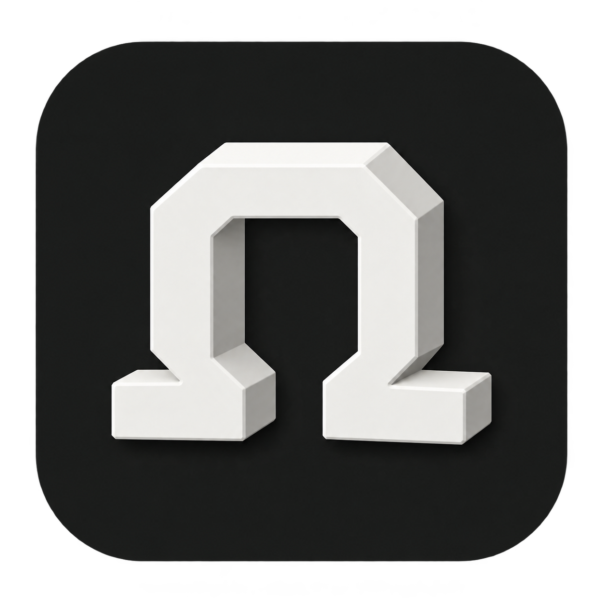

<p align="center">
  <a href="https://omega.naridon.com"></a>
</p>

<h1 align="center">Omega</h1>

<p align="center">A little less noise. A little more together.</p>

<p align="center"><a href="https://omega.naridon.com">Website</a> · <a href="https://github.com/MHASK/Omega/releases/latest">Download for Mac</a> · <a href="Relay/README.md#run-with-https">Self-host</a> · <a href="#connect-a-local-assistant">Connect an assistant</a></p>

A calm, open-source Markdown notes and tasks app for macOS, with live collaboration and a self-hostable relay. Files stay on your Mac and in Git. Use your existing GitHub or GitLab CLI login; no Omega account is needed.

**macOS 14 or later · Apple silicon · Apache 2.0**

[Download the latest release](https://github.com/MHASK/Omega/releases/latest)

## A small place for your work

- Edit ordinary Markdown files in your own folders. Assistant HTML comment markers stay hidden and are preserved when editing. Tables, images, math, slash commands, page links, and a selection toolbar.
- Organize notebooks with drag-and-drop ordering, folders, favorites, and archives.
- Find notes with ⌘K, then jump to the matching passage. Open Archive from the icon beside ⌘K in the sidebar footer.
- In notes, type `/task` for a checklist. Click the checklist icon beside a notebook or right-click a folder → **View tasks** for a complete folder workspace: list and board views, goals linked across pages, custom statuses, task and project progress, descriptions, dates, labels, and nested subtasks. Cards and rows show their source page; search and filter by page, or open the source directly. New work saves to the page you choose. Includes subfolders and task pages; excludes archives. Changes update the original files, with no duplicate task document.
- Simple task lists and boards, nested subtasks, descriptions, due dates, labels, and linked goals.
- Manage task statuses and shared pastel labels in Settings (⌘,).
- Extra task metadata from outside tools is preserved through edits, task moves, MCP changes and current-version live collaboration. Multiline JSON, optional null fields, BOM/blank prefixes, and `*` / `+` checklist bullets are accepted.
- Invalid imports explain the problem and line number. If the file was already open, its last valid task view remains available read-only; the latest Markdown is always the saved version. A valid outside repair automatically restores editing. Separate table rows are flagged without guessing how to rewrite them.
- Valid status names added by an outside editor are recognized even before they have a section heading. Imported goal status metadata is preserved; goal progress continues to follow linked work or its checkbox.
- Local recovery checkpoints, atomic file saves, persistent undo, and update backups.
- Optional Git notebooks with existing GitHub/GitLab CLI login.
- Live collaboration with named cursors and a [self-hosted, memory-only relay](Relay/README.md).
- Optional local MCP access for tools such as Claude Code and Codex.

### Folder tasks and source pages

The folder workspace uses the same task interface as task documents. Inline checklist details are stored in an invisible `omega-task` comment on the checklist line; the surrounding Markdown remains in place. Labels use the same settings catalog and pastel colors as task documents. A task can move under another task on its source page, or become a main task, keeping its metadata and descendants. To move whole blocks between notes, use the source documents.

Cross-page goal links store a relative page path and a durable item ID, so the links travel with your Git notebook. Folder progress is calculated from the original tasks and subtasks, not copies. Each task page retains its own status names; its completed status maps to the folder’s completed column. Folder views combine up to 12 distinct workflow statuses.

Before a folder edit is saved, Omega checks the affected files against the versions displayed. Outside changes stop a stale save and show **Copy changes** and **Reload**; the pending proposal is retained locally in `~/Library/Application Support/Omega/Folder task recovery`. Multi-page changes also use per-page backups and undo history. If a write fails after another page was saved, the notice identifies the partial save; reloading displays the actual source files.

## Diagrams and live references

Type `/mermaid`, `/chart`, or `/sequence` to insert a diagram. Mermaid source stays in an ordinary fenced Markdown block. Preview follows the app theme; **Source** edits the drawing, and **Expand** offers zoom and fit. Rendering is bundled and works offline. Invalid syntax stays inside its block, with its source preserved. Diagram-supplied external resources and configuration directives are disabled.

Type `/linked section` to choose a page or heading to quote. Omega reads that source while the note is open and refreshes it about every two seconds, including changes from outside editors. The destination stores only a relative reference in an `omega-quote` code fence. Nested live quotes are shown as source to prevent recursive inclusion. If a heading is renamed, duplicated, removed, or its page is unavailable, the quote asks you to choose the source again. Ordinary copied paragraphs remain independent text.

Task, subtask, goal, and task-page links display live progress. Use `/linked status` or `/linked progress` for a dedicated table cell or inline field. These are ordinary Markdown links labelled `Status` or `Progress`; Omega renders their current value without modifying the destination file. Task statuses use the exact source status, including custom states such as “In review.” Goal progress includes explicitly linked work from other pages in the same notebook. Existing prose summaries are not inferred or overwritten. These read-only projections create no undo steps or Git changes.

Back and forward arrows beside Settings (⌘[ / ⌘]) return to notes, folder task workspaces, task details, filters, and scroll positions. Board columns keep a readable minimum width and scroll horizontally when more statuses are present.

## Writing

- **Aa** at the top right changes document text size, Default / Serif / Mono typeface, and full width. The sidebar, tasks board and menus keep their own size. These are personal preferences on this Mac; `⌥⌘ +`, `⌥⌘ −` and `⌥⌘ 0` adjust/reset document size.
- Select text for bold, italic, underline, strikethrough, links, nine soft text colors and nine highlights. The color picker has a Default option to clear each style separately.
- Hover beside a block for **+** and a drag handle. Open the handle for type conversion, color, comments, duplication, movement, deletion, and word/character count. Hold and drag the handle to a drop marker. List items carry their nested content between lists or into their own list, and the document scrolls near its edges. Escape cancels; one Undo restores the move.
- Type `/` and filter by a block or action, including `/comment`, `/blue` and `/highlight`. Use ↑ / ↓ and Return. Type `@` to link a note, task, goal, or a collaborator currently present in the live session. Person mentions are references, not notifications.
- Select text and choose **Comment** (`⌥⌘M`) or use the block menu. The comment button shows open threads, replies, and resolved threads. Text anchors move with edits. If the anchored text is removed, the thread and its original quote remain in the comments panel.

The top-right window header has **Share**, **Comments**, and **Aa**. Color and highlight choices use compact tabs; comment threads have separate Open and Resolved views.

Colors and underline use small, allowlisted inline HTML tags in Markdown. Comments use inline anchors and hidden `omega-comment` records in the same local file, so Git saves them too. Comment records merge as separate items in live editing; concurrent replies are retained. Use the latest Omega on every collaborating Mac for the new formatting schema. Font preferences stay local. Other Markdown readers may display the tags differently, but the underlying text remains available. No AI service or notification service is involved.

## Install and update

Open the release **DMG** and drag **Omega.app** to **Applications**, then launch it from Applications. Starting with 1.3.2, official releases are Developer ID signed, notarized by Apple, and include stapled notarization tickets. The ZIP contains the same app for the automatic updater and manual installation.

Automatic update checks and downloads are **on by default in every DMG and ZIP installation**. Omega checks GitHub releases on launch when the last check is more than six hours old, and every six hours while running. It downloads newer versions and shows a small dot on Settings when an update is ready. Choose **Settings → About Omega → Restart to update**. You can also use **Omega → Check for Updates**. Automatic checks and downloads can be turned off in Settings; an update preserves your preference.

Every download is checked against its SHA-256 checksum, then verified against the application's bundle identity and Developer ID signing team. Omega saves your current work, backs up notes, preferences, undo/recovery data and the old app, and replaces the application. Notebooks stay in their chosen folders unless you explicitly request a move; their format stays unchanged. Downgrades and incompatible or tampered apps are rejected. A manual “Install Update from File” fallback is available.

Your notes live in the folders you choose. App data remains in `~/Library/Application Support/Folio`; update backups are in `~/Library/Application Support/Folio Updates`. These historical names preserve existing installations. Local recovery protects against app crashes, but an independent backup is still needed for disk loss.

An explicitly requested move can be queued locally for a future build in `Folio/Notebook Migrations/pending.json`. It contains a UUID `id`, absolute `source` and `destination` paths, and a numeric `minimumBuild`. This is a local maintenance mechanism, not a migration applied to other users. Before opening the notebook, Omega recovers drafts, verifies a complete backup, atomically moves the folder on the same disk, and updates links, favorites, archives, ordering, Git/live configuration and undo paths. Existing destinations are never replaced. The backup and a restart-safe journal remain under `Notebook Migrations/<id>`. Linked folders/worktrees and moves across disks require separate handling. Assistants should call `get_context` again after a move to discover the current paths.

## Connect a local assistant

Enable **Settings → Assistants → Allow assistant access**, then copy the MCP configuration into your client. For Claude Code:

```sh
claude mcp add --transport stdio --scope user folio -- /Applications/Omega.app/Contents/MacOS/Folio --mcp
```

Restart/reconnect the client after updating Omega. Omega stays responsive to assistant requests while in the background; linked-page parsing runs away from the UI, and stalled requests expire instead of blocking the connection. The service supports notes, folders, task pages, nested tasks, goals and goal links. Access is limited to open notebooks; writes use revision checks and saved history. Both you and an assistant can edit, with conflicting writes rejected instead of silently overwriting your work. No notes are sent to GitHub by the updater. A connected assistant handles note content according to that client's settings.

Open notes update as writes arrive. MCP clients identify themselves during connection, so Omega can show “Updated by Claude” or “Updated by Codex” beside the document controls. Changed passages briefly highlight without moving your selection. Direct filesystem edits are labeled “Updated externally” because a file write does not reliably identify its author. This is edit activity, not a simulated assistant cursor: MCP does not send a continuous caret position.

Omega watches the open file, including atomic file replacements, and keeps a periodic fallback check. Direct filesystem updates must remain unchanged for a short interval before display, avoiding partial-file flashes during chunked writes. Independent outside edits merge with unsaved typing; overlapping edits retain the local recovery copy and the outside file, with a review indicator instead of an automatic interruption. Updates wait while an editing dialog or text composition is active.

## Agent planning and Beads migration

Omega keeps the shared plan; Claude Code and Codex manage their own worktrees,
branches, sessions and tests. Task pages and folder task views now have a **Ready**
tab and a compact **Work & handoff** section for assignment, prerequisites,
blockers, review notes, and repository/branch/session/PR references. These fields
stay in the task's original Markdown, including tasks inside ordinary notes.

In **Settings → Assistants → Work with your agents**, choose a notebook and use
**Set up a project…** to add a managed workflow section to the code project's
`AGENTS.md` and `CLAUDE.md`. Existing instructions are preserved and backed up.
Use **Connect** for the Claude Code or Codex MCP registration command. Setup
does not start an agent, make a worktree, initialize Beads, or change global
client configuration. Keep Omega open with assistant access enabled.

Agents call `get_context`, `read_work_queue`, and `claim_task`, then keep the
returned claim receipt for updates, release and handoff. Mutations require the exact
task revision (or the legacy source revision). A timeout must be followed by a fresh read, never a blind retry.
Ready means unassigned, unclaimed, saved work in the first open status, with
every prerequisite complete. Drafts, missing dependencies, dependency loops,
explicit blockers, review work, and already-started tasks are excluded.
Cross-page prerequisites must have durable IDs; `ensure_task_identity` and
`set_task_dependencies` handle this without duplicating tasks. Use the folder
task view or agent queue for cross-page readiness; a single task page
conservatively treats prerequisites outside its loaded page as unavailable and
links to their source.

`handoff_task` stores decisions, changes, tests and next steps, releases the
claim, and normally requests human review. It never marks work Done. For an
unfinished handoff that another agent should pick up, explicitly return the task
to the first open status and pass `needs_review: false`. Claims do not expire or
get stolen automatically. A stopped agent's receipt is retained in the task
metadata for deliberate recovery through `read_task_page` and `release_task`.

For agent work, prefer `read_task(path, task_id)` and then pass `task_id` plus
`expected_task_revision` to `update_task`, `configure_task_work`, `claim_task`,
`handoff_task`, or dependency tools. These calls default to compact receipts;
changes to unrelated tasks do not invalidate the token. A change to the same
task, its ancestry, or the page's status configuration does. Legacy positional
calls still require `expected_revision` and return a full page unless you pass
`response_format: "compact"`. Raw Markdown replacement always guards the whole
page. Read a legacy task by reference and use `ensure_task_identity` first.

`edit_tasks` validates up to 100 add/update operations in memory, then saves
**one page atomically** through the normal editor, backup, recovery and undo
path. Updates carry their own task revisions; additions append to the latest
page. An optional page revision guards the entire batch. Use `client_id` on an
add and `parent_id: "$client_id"` on a later add for nested tasks in one call.
An invalid operation, stale token or missing claim receipt rejects the batch.
A timeout is ambiguous: inspect the tasks before attempting additions again.
Cross-page transactions and distributed writes are not supported.

The queue supports `state`, `status`, `label`, `assignee`, `query`, and `priority`
filters. Results default to 50 compact summaries, ordered by P0–P4 (unspecified
priority sorts with P2). Follow `next_offset`; pass `expected_queue_revision`
from the previous result to detect changes while paging. `include_details: true`
returns full metadata; use `read_task` for one task's context. Priority is editable
in **Work & handoff**, visible on cards/lists, and preserved in Markdown and live
collaboration. The Ready view sorts by priority.

The same API works from the shell while Omega is open:

```sh
printf '%s' '{"path":"/absolute/notebook","state":"ready","label":"pr"}' | \
  /Applications/Omega.app/Contents/MacOS/Folio --agent-call read_work_queue
```

After an app update, reconnect `folio` in the client's MCP menu (or start a new
session) to refresh its tool schema. Reading a file with shell commands proves
the file exists; it does not test the MCP connection.

**Claim coordination is local to one Mac.** The same-user MCP service serializes
claims; Git and live editing are not a distributed lock service. For a shared
Git/live notebook, **Use this Mac…** records the coordinator in
`.omega/coordination.json`. All claiming agents must use that Omega instance.
Other replicas without the matching coordinator identity refuse claims. Do not
designate separate replicas independently. This is a cooperative workflow,
not an access-control boundary: humans and raw file editors can still change
task metadata. Cloud-wide agent claims and remote agent execution are not
implemented.

To migrate an existing [Beads](https://github.com/gastownhall/beads) project,
run `bd export --no-memories -o omega-beads.jsonl` in that project, then choose
**Import Beads…**. Review the preview before creating a new task page. Hierarchy,
blocking dependencies, supported statuses, P0–P4 priorities, labels, assignees and handoff notes
are mapped into Omega. Original records—including comments and
other Beads fields—remain in metadata; unsupported relationships are flagged for
review. Missing prerequisites remain blocked. The original Beads project is
unchanged. This is a **one-time import**, not bidirectional Beads synchronization
or full Beads feature parity. After verifying it, choose one task authority for
ongoing work.

Agent coordination and Beads import shipped in 1.3.13. The compact task API,
batches and priority controls are included in 1.3.14.
Regression checks cover claim competition, stale revisions, ownership receipts,
dependency loops, missing and cross-page targets, inline checklist preservation,
idempotent setup, actual Beads 1.0.3 export records, concurrent handoffs, and the
shared editor's Ready/detail views.

## Git notebooks

Open **Settings → Git sync**. Choose GitHub or GitLab, then **Open Git folder** for an existing repository or enter its HTTPS URL and choose **Clone repository**. The repository becomes a normal notebook in the sidebar. Repositories must have an `origin` HTTPS remote; use the repository's top folder. Nested GitLab groups and self-hosted hosts are supported by the selected CLI's existing host login.

Omega calls the installed `gh` or `glab` credential helper for that host. It does not create an Omega account, copy tokens into its settings, or change your global Git configuration. Sign in once with `gh auth login` or `glab auth login` if needed, and configure your usual Git commit name/email. A login supplied only through a terminal environment variable is available only to processes launched with that environment; use the CLI's persistent login for apps opened from Finder.

**Automatic sync** is on for connected Git notebooks. While Omega is open, it saves a snapshot about every 30 seconds, commits changed Markdown/text notes and image/PDF attachments, merges incoming changes, and pushes. Live editing stays connected. Turn **Sync automatically** off per notebook in Settings → Git sync, or use **Sync now** at any time. Existing repository history is shared too, so use a repository intended for these notes. Hidden files and unrelated new files are not automatically committed. Preferences, archive/favorite flags, undo history, and shared label colors remain local to each Mac. Connecting a Git notebook enables automatic publishing to its existing repository. Ordinary, unconnected notebooks remain local. Offline saves stay on your Mac and retry with a backoff when the connection returns.

**Share** in a note’s header shows its repository and branch, copies a link to the last synced version, and opens sharing setup for a local-only notebook. The repository owner or organization manages access in GitHub/GitLab; copying a note link does not invite anyone or change permissions. Repository access includes its files and history, not only the linked note. New notes need a Git sync before their link is available. There is no new Omega owner: each collaborator retains their local copy.

For a team: use a dedicated repository, give collaborators write access, and connect the same repository and branch on each Mac. Their existing GitHub/GitLab CLI login is used. Enable the same trusted relay in **Settings → Git sync → Live editing** to edit together. Share does not automatically publish local notes or change repository visibility.

Incoming changes are merged in a private worktree, away from open files. Compatible shared checkpoints merge through Yjs, preserving edits made during the fetch, cursors and author-local undo. Ordinary text conflicts, different shared baselines, attachment conflicts and deletion conflicts appear as **Review changes** in Git settings and **Review** in the notebook footer. Review opens a full workspace with a file sidebar, split or unified Git diffs, and an editable result. Move between conflicting sections, compare with the original, and use the current change, incoming change, or both. Non-conflicting edits are combined by Git. Mark the file resolved when the result is ready. The File actions menu can keep a complete version or keep two files, creating a uniquely named incoming sibling. Review drafts and per-conflict choices are saved locally as you work. Both original commits remain protected by local Git backup references. Unfinished reviews survive an app restart and can be resolved offline; the result pushes when the connection returns.

A resolution is checked against the copies you reviewed. If another app or collaborator changes the notebook during review, Omega prepares the latest copies instead of overwriting that work. There are no force pushes or resets of working files. Pre-existing staged changes, an unfinished merge/rebase, or incoming changes outside the supported note/attachment scope still need attention in Git. Automatic retries never discard those changes.

Git sync saves files and their history. Optional live editing shares concurrent changes through a memory-only relay; it requires a connected Git notebook and repository write access. The local assistant integration continues to use revision checks to protect concurrent writes.

## Build

Install Xcode Command Line Tools and Node.js 22 or later:

```sh
npm ci --prefix Editor
npm test --prefix Editor
npm run build --prefix Editor
./build.sh /absolute/path/Omega.app
```

The native app is SwiftUI/AppKit with a local Tiptap editor. Editor resources and dependency notices are bundled into the app; no CDN is used. Build output is arm64, targeting macOS 14. Development builds are ad-hoc signed and are not accepted by the official updater.

Run native checks on an Apple silicon Mac:

```sh
/path/Omega.app/Contents/MacOS/Folio --self-test
/path/Omega.app/Contents/MacOS/Folio --mcp-test
/path/Omega.app/Contents/MacOS/Folio --undo-test
```

Run Git synchronization checks with isolated temporary repositories (including live editing and the in-app review):

```sh
xcrun swiftc GitSync.swift LiveCheckpointStore.swift Tests/GitSyncCheck.swift -o /tmp/Omega-Git-Check
/tmp/Omega-Git-Check
xcrun swiftc GitSync.swift LiveCheckpointStore.swift Tests/GitAutoSyncCheck.swift -o /tmp/Omega-Auto-Git-Check
/tmp/Omega-Auto-Git-Check
./Tests/check-git-app.sh
```

Tests use temporary notes and isolated preferences. GitHub Actions runs editor and native checks on pushes and pull requests.

## Linux status

A Linux desktop release is **not available yet**. The release requirement is full Mac feature parity, including Git sync and review, live cursors, settings, MCP, recovery, and a verified update path. A limited notes-only build will not be published as a completed Linux port.

The shared Swift package compiles the actual task/checklist, file-link, Git sync/merge, recovery, SQLite undo, and CRDT-checkpoint storage code on Linux. Run `swift test` with Swift 6.2 or newer, Git, and SQLite development headers. The same editor and memory-only relay tests also run on Linux. These checks establish data compatibility; they do not constitute a Linux desktop app. See [the parity checklist](Portable/README.md).

## Publish a release

The maintainer publishes from a Mac with the official Developer ID certificate. Signing credentials stay in Keychain. Notarization credentials come from an existing Keychain profile or the process environment, never GitHub or the repository.

1. Build editor resources and run the checks above.
2. Set `FOLIO_NOTARY_PROFILE` to an existing Keychain notarization profile, or supply `APPLE_ID`, `APPLE_PASSWORD` (an app-specific password) and `APPLE_TEAM_ID` through the environment. Run `./release.sh 1.3.2 132 /absolute/release/path` with a higher version and build number. Set `FOLIO_SIGN_IDENTITY` to the signing identity if needed. Notarization is mandatory: the script notarizes and staples both the app and DMG, and validates them with Gatekeeper before producing the update manifest.
3. Review and commit the version changes, then push `main`.
4. Run `./publish.sh /absolute/release/path /absolute/release-notes.md`.

The publish script requires valid signatures and stapled notarization tickets, verifies checksums, then uploads the DMG, update ZIP, checksums and `Omega-update.json` as a draft GitHub release before publishing it. Installed copies discover it automatically. Build checks never receive signing keys or publish unsigned updates. Do not replace assets of a published release; ship a higher version/build instead.

Forks should use their own repository, app identity and signing requirement before distributing their own update channel.

## Compatibility

Keep `local.folio.notes`, `FolioDataFormatVersion`, the `Folio` executable, Markdown markers, stable task/goal IDs, `folio://` links and preferences keys intact for the official app. These preserve notes, undo history, permissions and existing MCP setups. Never rename user notebooks as part of a product-name change.

Shared label colors are stored in `Settings/labels.json` under the app data directory. Rename/remove operations cover open notebooks, including archived task pages, and keep recoverable previous versions. Closed notebooks are not modified.

## License

Original code: [Apache License 2.0](LICENSE). Third-party components keep the licenses listed in [NOTICE](NOTICE) and the bundled resource notices.

### Live collaboration

Settings → Git sync now includes **Live editing**. Connect the same Git repository and branch on each Mac, set your trusted relay address, and enable it. Open the same note to write together; the footer shows Live and the people present. While connected, small initials beside sidebar files show other people currently in those files on the same repository and branch. Hover to see their names. Offline or disconnected activity is not shown, and the relay stores no presence history. Collaborators have a small pastel cursor with their verified GitHub/GitLab name and a soft highlight over selected text. Cursor positions follow the text as others edit, including when several people share the same paragraph. Notes, task fields, subtasks, and linked goals merge through Yjs. Local recovery remains active while offline.

The hosted relay for this installation is `https://omega.naridon.com`. It permits repositories under `MHASK` on GitHub and `ashiqwayanad007` on GitLab, with each participant's write permission checked separately. Other deployments can choose their own allowlist. No note is uploaded simply by installing the app.

[Relay setup and trust model](Relay/README.md) includes Docker Compose, HTTPS, access checks, and the zero-persistence model. Git carries notes, attachments, and the shared editing checkpoints under `.omega/live/`. Live editing shares open document contents; the relay never writes them to disk and forgets a room when its last participant leaves. Git sync runs alongside live editing; no pause or reconnect is needed. Live undo is author-local within the session; durable Markdown history stays local.

Cursor and selection updates are ephemeral: they never enter Markdown, Git checkpoints, or undo history. Visual and source notes show precise carets and selections; task titles do too. Task descriptions show a small named editing indicator. Cursors disappear on disconnect and return after reconnecting.
